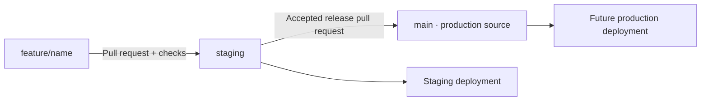

# Git workflow and staging

Repository: [oderannaji/rev](https://github.com/oderannaji/rev).

Use one repository with a separate branch for each feature. Separate repositories would make merging these closely related app changes harder.



`staging` is the combined pre-production branch. It begins with the existing `integration/web` work. The old branch is retained for history and existing users; new feature PRs target `staging`. `main` is the production source branch, but no production service is being published or promoted by creating staging. Its existing baseline remains until a release is accepted.

Create each new feature from current staging:

```bash
git fetch origin
git switch staging
git pull --ff-only
git switch -c feature/your-feature
# Make and test your changes, commit, then:
git push -u origin feature/your-feature
```

Open a PR into staging. The **Build and test** GitHub Actions job runs Node tests, the production build and browser tests. Once merged and accepted in staging, open a staging → main PR for production promotion. A future production host should track main; the staging host tracks staging.

The workflow file is not a branch-protection rule. In GitHub Settings → Rules → Rulesets, require pull requests and the Build and test status check on staging and main; prevent force-pushes and deletion, and require a review for main if the repository's reviewer setup allows it. Do not require a second person's approval in a single-owner repository unless a reviewer is available. These server-side rules must be enabled through GitHub settings/API access; they are not installed by committing this document.

## Update your Mac without downloading ZIPs

Clone once into a new folder, keeping your existing app/data folder until the migration is checked:

```bash
git clone --branch staging https://github.com/oderannaji/rev.git shepherd-pro
cd shepherd-pro
npm ci
npm run build
npm start
```

If you previously used a ZIP, stop the old server and copy its `.local` directory into the new clone before starting. That preserves settings, imported translations, media and saved services. Existing absolute Whisper paths and installed Ollama models do not need reinstalling. Check that Settings shows the expected paths.

After that, stop the running server with Ctrl+C and run:

```bash
npm run update:staging
```

This fetches staging, fast-forwards without overwriting local edits, installs dependencies only if needed, builds and starts the app. It preserves `.local`. It does not merge uncommitted changes, discard diverging commits, or download models. For an existing feature checkout, the same script can use `bash scripts/update-local.sh feature/name`.

Hosting is deferred by choice: keep the app and AI models on the Mac for now. There is no Render/Cloudflare deployment and no automatic production publication. The staging branch is a Git testing branch, not a hosted website. If hosting is chosen later, Render is the closer fit for this Node server and persistent data; Cloudflare Pages alone does not run this backend. Either cloud setup would need a separate design to access local Mac models.

GitHub Actions runs app tests with fixture model responses; it does not prove real Whisper/Ollama accuracy on the Mac. Server-side branch rules are still pending: the GitHub API was blocked by the environment proxy during setup. The Git pushes work, but that is separate from repository-settings API access.
