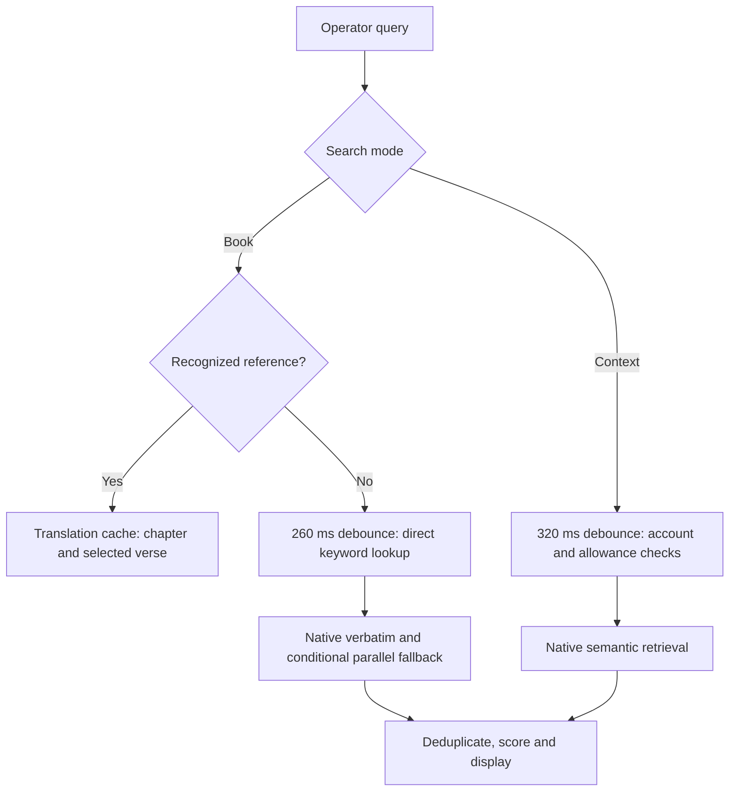

# How Pewbeam search works — evidence from your installer

Inspected **Pewbeam 2.6.14, macOS ARM64**, from the three uploaded parts. This is a static investigation of the shipped package. Pewbeam was not executed, no subscription was changed, and no vendor service was called.

## What happens when you search

The current interface has two paths, **Book** and **Context**:

1. **Book/reference lookup:** the UI parses a book/chapter/verse reference, supports aliases and spoken number normalization, then loads the chapter from a translation cache and marks the requested verse. A valid reference bypasses the free-text debounce. Evidence **S2**, plus formatted bundle functions `eB` at 56619 and `Zp` at 72782.
2. **Book/free-text lookup:** queries need at least two characters. The UI waits **260 ms**, checks that the query is still current, and runs the text fallback chain. Evidence **S3**.
3. **Keyword matching:** the direct matcher lowercases the verse and query and requires **every query token to occur as a substring** of the verse. Its score starts at **0.7**, adds bounded bonuses for token count, an early occurrence, query-to-verse length, and proximity, and caps the result at 1. These are actual expressions in the shipped JavaScript, not inferred product descriptions. Evidence **S4–S5**.
4. **Fallback retrieval:** Book search initially searches the selected and other available same-language translations. If it has enough results it returns immediately. Otherwise it also invokes native verbatim search; when direct results are empty it tries the parallel helper with fuzzy disabled. Results are deduplicated and sorted. Evidence **S8**; `BF` / `FF` at 55911–55934.
5. **Parallel helper:** a reusable helper can run direct, fuzzy, parsed-reference and shingle searches. Its merger prioritizes parsed reference, shingle, direct, then fuzzy for duplicate verse identities. Score transforms are `0.95 + .05s`, `0.90 + .05s`, `0.85 + .05s`, and `0.70 + .14s` respectively. **This does not mean every manual query runs all four paths**: the current Book fallback disables fuzzy in that helper. Evidence **S6**, `oB` at 56770, `sB` at 56830.
6. **Context search:** queries need at least three characters and wait **320 ms**. The UI requests **10 results** with minimum score **0.5**, through native `search_verses_semantic`. It increments the free counter when results are nonempty. A sign-in/initialization check and lifetime allowance gate run before the native call. Evidence **S1, S7**.

## What the native binary adds

The Mach-O contains file paths and surviving Rust symbols for **EmbeddingGemma ONNX inference**, precomputed float32 verse vectors, **BM25**, and a reranking stage. It also contains an optional **MiniLM cross-encoder** resource and fail-open messages for unavailable reranking. Direct references take priority in the live-speech pipeline; diagnostic branches mention duplicate suppression, timeouts, concurrency limits, and TTL/LRU caching.

This supports a hybrid lexical/neural architecture. It does **not** establish the exact vector dimension, fusion constants, enabled model state, ranking quality, or measured latency. A local model path is not proof the model was installed. The native evidence is itemized with exact executable offsets in [NATIVE_EVIDENCE.md](NATIVE_EVIDENCE.md).

## Free, Plus, Core, and “Premium”

The installer’s plans are **Explorer (Free), Plus, Core**. “Premium” appears in theme names, not a fourth subscription-plan enum.

- Free defaults: 60 lifetime transcription minutes, 200 metered semantic searches, one AI generation, watermark and limited themes. The semantic allowance should not be generalized to all local reference/keyword lookups.
- Plus: unlimited transcription and AI generation in the comparison UI, offline speech, notes, Greek/Hebrew study, all themes, four display outputs, and no watermark.
- Core: three device activations, simultaneous machines, priority support, and an advanced-AI entitlement.

These are bundled definitions, **not a verification of today’s price or server policy**. Server counters can override default limits. See [FEATURE_MATRIX.md](FEATURE_MATRIX.md) for the complete findings and discrepancies.

## Evidence you can inspect

- [Bounded source excerpts](evidence/search-excerpts.txt): S1–S8 for search; T1–T2 for tiers. These are documentation excerpts, not code used by Shepherd Pro.
- [Evidence manifest](evidence/manifest.json): hashes, compressed-asset offsets, source ranges, and REA evidence identifiers.
- Original DMG SHA-256: `e0dd053d8fb4ac2536180438bb744cbab1c584bd0b5c496c28551cd821fcddf8`.
- Native executable SHA-256: `6118e46780eb424666bdbcbaa96ae6f34d5267a83017e44c1d795eaca53150e2`.
- REA artifact evidence: `ev_1d22ef61735360fc092a4e378e63b95a3c3fa444ae845e571e3cbcf2e0fe0214`.
- REA JavaScript evidence: `ev_a01cae83c09bfbf92215e80acdb49efb50ee27db1cbdefc39a79084e67dd204b`.

The Linux REA DMG adapter recorded the root identity but could not inventory children. A separately installed, package-verified 7-Zip extracted the HFS container. An inert extraction script then located Tauri asset pointer/length records and Brotli-decompressed 335 resources. REA parsed the main 1,754,867-byte JS bundle: 363,754 AST nodes, zero parse failures. Its Electron-specific IPC summary is empty because this is Tauri; that is not evidence of no native bridge. The complete local analysis remains under `/workspace/pewbeam-analysis`; the repository includes only bounded, credential-free findings.

## Shepherd Pro’s implementation choices

Shepherd Pro is independent code with its own name, interface, datasets, and persistence. Reference search and typo-tolerant lexical search are implemented locally. **Topic mode expands an explicit synonym dictionary. Context mode now integrates a local Ollama embedding model with a persisted verse index and lexical rank fusion.** The new integration is tested with fixture embeddings; real model installation and retrieval-quality evaluation are still pending. It is not a reproduction of Pewbeam’s exact ranking. Imported translations, the local lexicon, queues, slides, themes and presentation windows work without a subscription. No copied vendor credentials, licensing endpoints, application assets, commercial translation files, or runtime service calls are used.

Full feature parity is **not established**. [IMPLEMENTATION_STATUS.md](IMPLEMENTATION_STATUS.md) lists implemented capabilities, approximations, and the native/provider work still outstanding.
